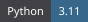
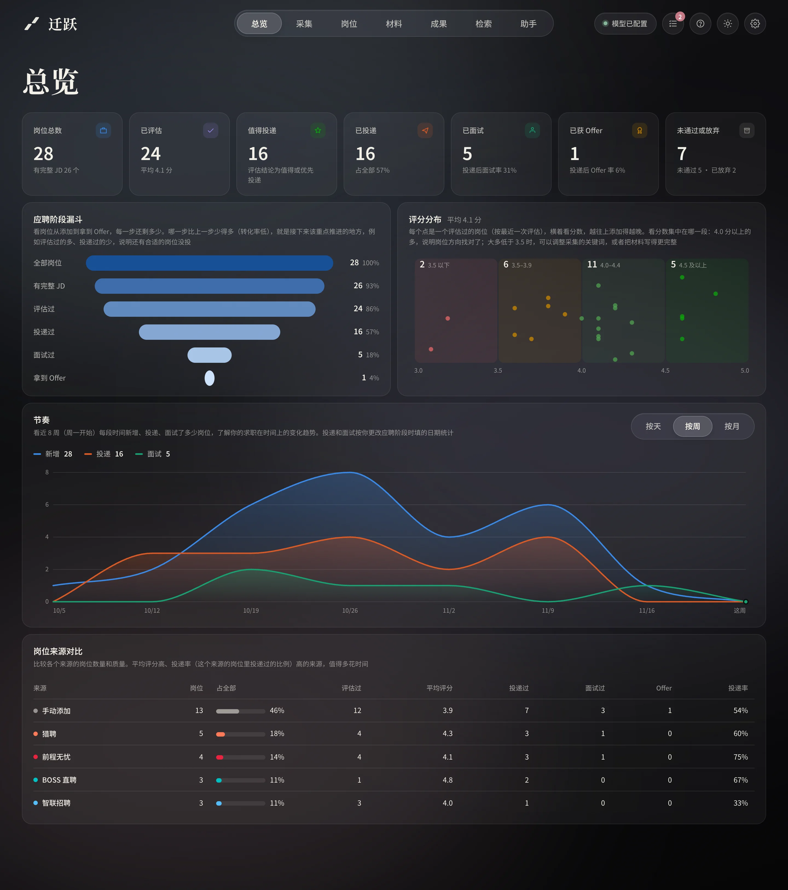
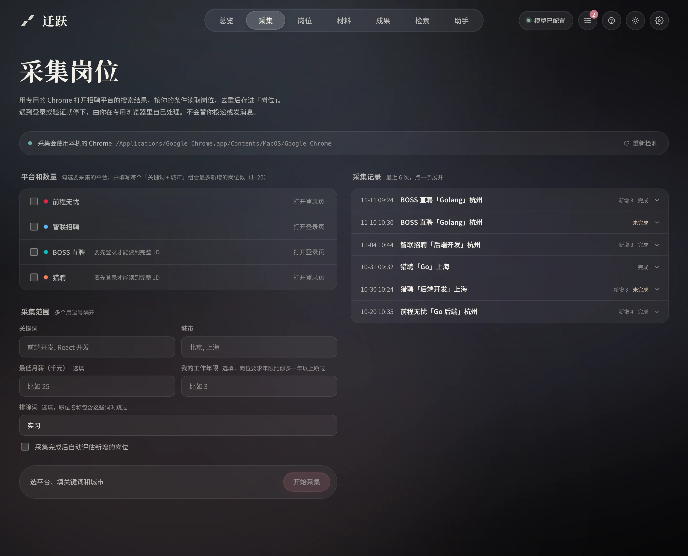
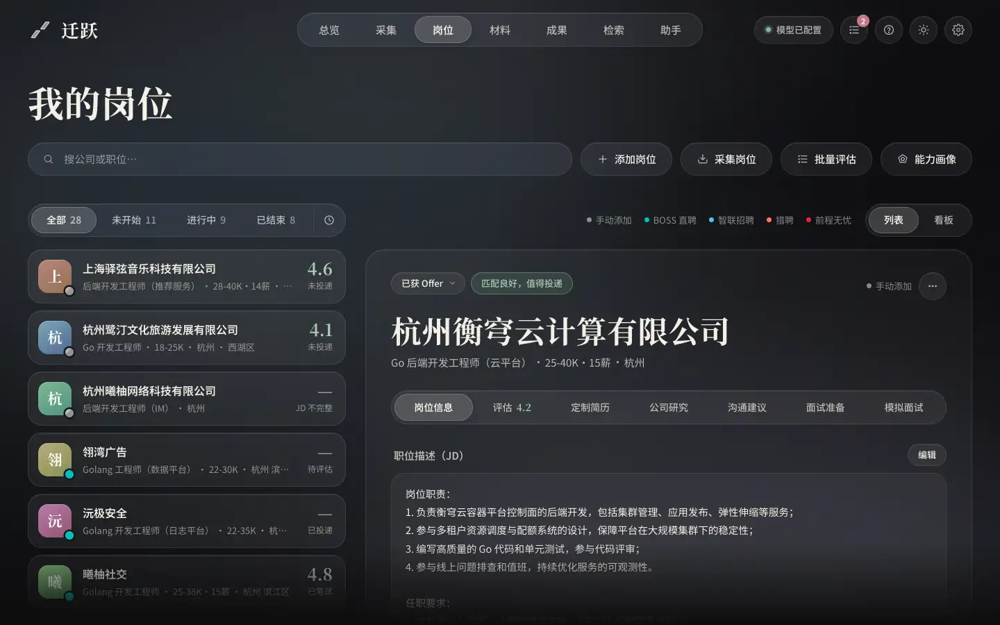
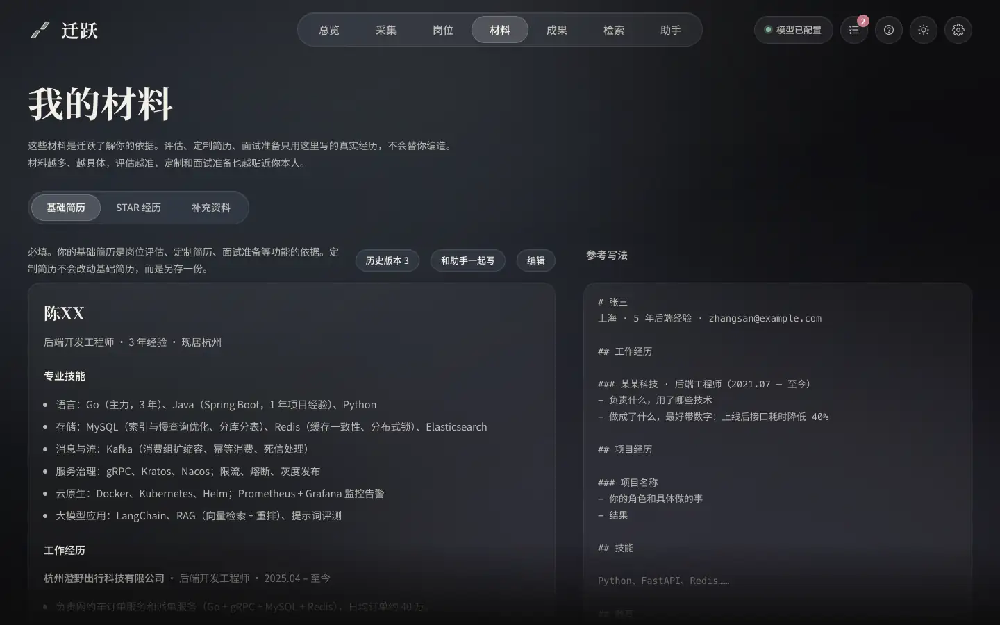
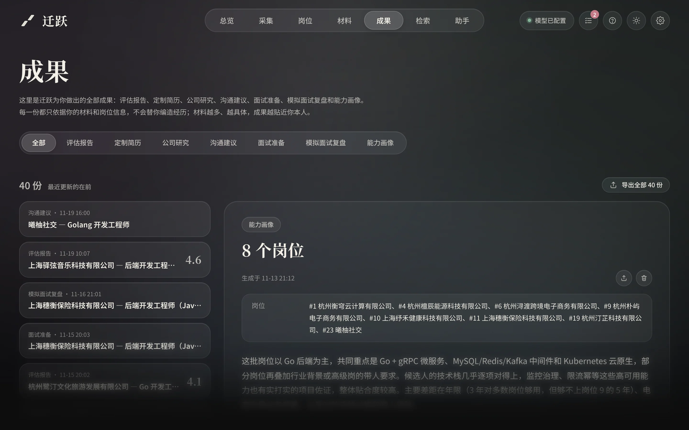
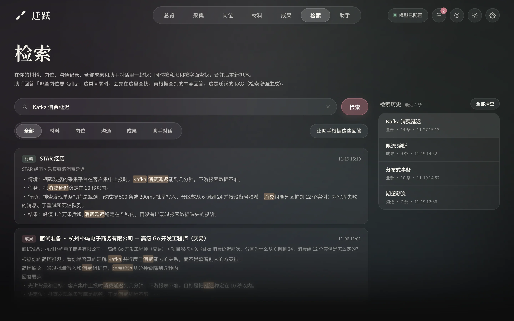
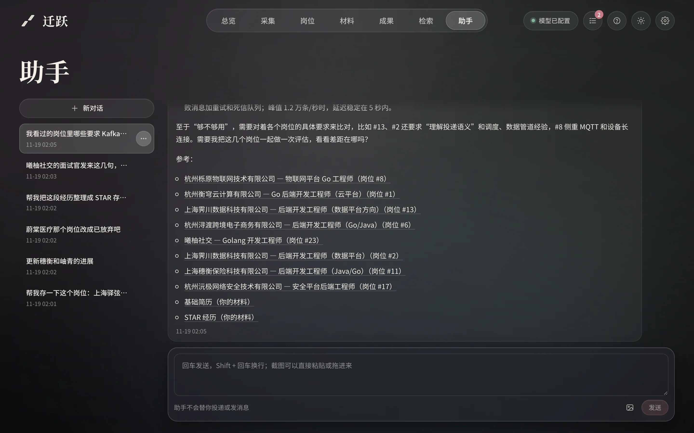
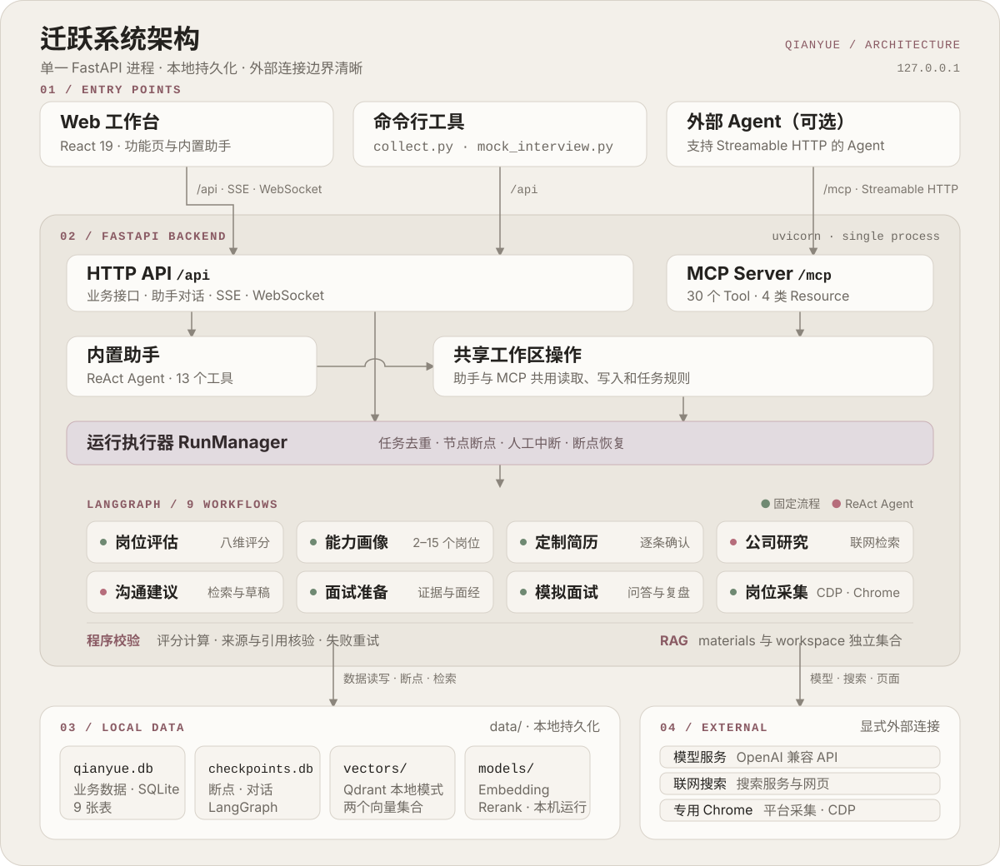

<h1 align="center">迁跃 Qianyue：本地运行的 AI 求职工作台</h1>

<p align="center">
  
</p>

<p align="center">
  <a href="#技术栈"></a>
  <a href="#技术栈"></a>
  <a href="#技术栈"></a>
  <a href="#技术栈"></a>
  <a href="#通过-mcp-接入外部-agent"></a>
  <a href="#本地隐私与安全"></a>
  <a href="#招聘平台支持"></a>
</p>

<p align="center">
  <a href="#概述">概述</a> ·
  <a href="#核心能力">核心能力</a> ·
  <a href="#功能概览">功能概览</a> ·
  <a href="#快速开始"><strong>快速开始</strong></a> ·
  <a href="#ai-使用方式">AI 使用方式</a> ·
  <a href="#招聘平台支持">招聘平台</a> ·
  <a href="#本地隐私与安全">隐私</a> ·
  <a href="#架构">架构</a> ·
  <a href="#目录结构">目录结构</a>
</p>

---

## 概述

找工作时，岗位散在好几个招聘平台，要一份份读 JD、掂量值不值得投；每投一个都得改一版简历；投多了还记不清哪个岗位走到了哪一步。迁跃把这些大耗精力的事统一办好：它在本机运行，按你的求职条件收集岗位，用自己的简历评估匹配度，再在同一条岗位记录中定制简历、研究公司、准备沟通和面试。

在「总览」查看评分分布、投递节奏和各阶段进展，在「成果」查看或导出报告。「检索」可搜索材料、岗位、沟通记录、成果和助手对话。内置助手可以查询这些内容、引用相关记录，也可以发起岗位评估等任务。

## 核心能力


| 模块               | 你操作什么                                                                       | 你得到什么                                                                       |
| -------------------- | ------------------------------------------------------------------------------------ | ------------------------------------------------------------------------------------ |
| 岗位采集与录入     | 填关键词、城市和筛选条件开始采集；或手动粘贴 JD、链接、招聘页截图。               | 不同平台的岗位去重后汇进同一个列表，薪资、来源和每次阶段变更都记在同一条岗位记录。 |
| 岗位评估           | 选中一个或一批岗位，点「开始评估」。                                             | 八个维度逐项评分、写出依据，给出加权总分和投递建议。                               |
| 能力画像           | 勾选 2–15 个目标岗位，点「能力画像」。                                           | 汇总这些岗位反复要求的能力，对照你的材料列出已有证据和差距。                       |
| 应聘进展           | 在看板把岗位卡片拖到下一阶段（或用「移到…」），填上日期；沟通记录贴进对应岗位。  | 看板按应聘阶段分列、进展一目了然；总览自动汇总投递节奏、转化率和各渠道进展。       |
| 简历定制           | 对照你的基础简历，逐条审阅 AI 提出的修改，只勾选你认可的。                       | 确认后生成岗位版简历，单独保存、不改动你的原件。                                   |
| 公司研究           | 在岗位页点「开始研究」。                                                         | 附有公开来源引用的公司研究报告。                                                   |
| 沟通建议           | 把聊天记录或截图贴进这个岗位。                                                   | 分析招聘方在问什么，起草回复草稿；发不发、怎么发由你决定。                         |
| 面试准备与模拟面试 | 查看整理好的问题清单，开始模拟面试并逐轮作答。                                   | 针对这个岗位的问题和回答要点，结束后留下一份复盘。                                 |
| 成果与检索         | 在成果页按类型筛选、导出；在检索页搜关键词，或直接问助手。                       | 报告自动归档、可单份或打包导出；关键词或语义检索直达命中原文。                     |

## 功能概览

<p align="center"><sub><b>总览</b>：岗位数量、应聘阶段、评分分布、投递节奏和来源统计。</sub></p>
<p align="center">
  <a href="media/readme/screenshots/overview.webp"></a>
</p>

<p align="center"><sub><b>采集</b>：按平台、关键词、城市和筛选条件读取岗位；遇到登录或验证时暂停，由用户处理。</sub></p>
<p align="center">
  <a href="media/readme/screenshots/collect.webp"></a>
</p>

<p align="center"><sub><b>岗位</b>：在岗位信息、评估、定制简历、公司研究、沟通建议、面试准备和模拟面试七个页签之间切换，也可切到看板按应聘阶段拖动跟进。</sub></p>
<p align="center">
  
</p>

<table>
<tr>
<td width="50%" valign="top">
<br/>
<sub><b>材料</b>：基础简历、STAR 经历和补充资料三个页签。</sub>
</td>
<td width="50%" valign="top">
<a href="media/readme/screenshots/artifacts.webp"></a><br/>
<sub><b>成果</b>：左侧筛选成果，右侧阅读选中的报告。</sub>
</td>
</tr>
<tr>
<td width="50%" valign="top">
<a href="media/readme/screenshots/search.webp"></a><br/>
<sub><b>检索</b>：检索结果列出来源和命中片段，并高亮匹配文字。</sub>
</td>
<td width="50%" valign="top">
<a href="media/readme/screenshots/assistant.webp"></a><br/>
<sub><b>内置助手</b>：对话中显示任务进度、关联岗位和参考来源。</sub>
</td>
</tr>
</table>

以上截图使用示例求职数据。

---

## 快速开始

第一次使用可以先跑通一次岗位评估。你需要一份基础简历、一段完整的 JD，以及自己的模型 Key。

不想先安装，可以打开[在线演示](https://qianyue-ai.pages.dev/demo/ "不用安装，用一份虚构的求职记录把每个页面看一遍")把每个页面看一遍；本地版第一次打开也会先展示示例数据，随时可以退出。

### 环境要求

- [uv](https://docs.astral.sh/uv/)：负责准备 Python 3.11 和后端依赖。启动脚本优先使用本机已有的 uv，找不到时会自动安装到项目的 `tools/`。
- [Chrome](https://www.google.com/chrome/)：用于从招聘平台采集岗位。手动录入岗位时可跳过安装。
- **操作系统：** 支持 macOS、Linux 和 Windows 10/11。

首次启动后，约 1.1 GB 的本地检索模型会在后台下载。页面可以先打开，首次检索可能需要等待。

### 启动

下载并解压本仓库，或克隆到本机。

**macOS：** 在访达里双击 `start.command`，也可以在终端进入仓库根目录运行 `./scripts/start/start.sh`。

**Windows：** 双击 `start.bat`，也可以在 PowerShell 里进入仓库根目录运行 `.\start.bat`。

**Linux：** 在终端进入仓库根目录，运行：

```bash
./scripts/start/start.sh
```

看到终端显示启动地址后，在浏览器打开 [http://127.0.0.1:8000](http://127.0.0.1:8000)。使用自定义端口时，以终端显示的地址为准。

> 注：
>
> **macOS：** 若系统拦截 `start.command`，请打开「系统设置 → 隐私与安全性」，在被阻止的提示旁点「仍要打开」。
>
> **Windows：** 第一次运行时如果 Windows 防火墙弹窗，可以直接取消：迁跃只在本机 `127.0.0.1` 上服务，不需要对外开放。

### 首次配置

1. 在右上角「设置」中填写 OpenAI 兼容模型服务的地址、模型名和 API Key，保存后立即生效。使用截图录入时，模型需支持图片输入。
2. 在「材料」中粘贴并保存基础简历，这是岗位评估的必要输入。求职方向、期望城市与月薪、出差条件可写入补充资料。
3. 在「岗位」中点击「添加岗位」，粘贴 JD、链接或招聘页截图；也可通过「采集」读取招聘平台岗位。仅填写链接时，岗位会标记为「JD 不完整」，开始评估前需补充职位描述。
4. 选中岗位，在「评估」页点击「开始评估」。完成后可继续定制简历、研究公司和准备面试。

评估完成后，在该岗位的「评估」页查看总分、八个维度的依据和投递建议。

详细配置见[设置与配置](docs/usage.md#设置与配置)。启动或运行中遇到问题，可按现象查阅[常见问题与排查](docs/usage.md#常见问题与排查)。

## AI 使用方式

### 迁跃内置助手

在工作台直接操作，或打开内置助手，用自然语言查询材料、保存岗位和发起任务。例如：“用我的简历评估这个岗位，再列出面试前需要补充的材料。” 投递简历和发送消息始终由你完成。

### 通过 MCP 接入外部 Agent

如果习惯在外部 Agent 中工作，可通过 MCP 连接迁跃。默认地址为 `http://127.0.0.1:8000/mcp`，传输方式为 Streamable HTTP。客户端配置、工具清单和确认要求见[使用指南](docs/usage.md#通过-mcp-接入外部-agent)。

**没有模型 Key 也能用全部 AI 功能。** 连上以后，在 Agent 里说「用迁跃评估岗位 #12」，由你的 Agent 替迁跃的模型完成评估、定制简历、公司研究等步骤，迁跃照常做程序校验并保存结果。详见[由你的 Agent 代答](docs/usage.md#没有模型-key-时由你的-agent-代答)。

## 招聘平台支持

岗位采集支持以下平台。平台登录状态、页面结构和访问限制会影响可读取的数据范围。


| 平台      | 读取完整职位描述的登录要求 |
| ----------- | ---------------------------- |
| 前程无忧  | 可不登录                   |
| 智联招聘  | 可不登录                   |
| 猎聘      | 必须登录                   |
| BOSS 直聘 | 必须登录                   |

仅保存列表时，未登录也可取得部分岗位。各平台的数量限制见[使用指南](docs/usage.md#采集)。

## 本地隐私与安全

- 简历、岗位、沟通和报告保存在本机，本地检索也在本机完成。备份可能包含明文 Key 和招聘平台登录状态，请按私人文件保管。
- 使用远程模型时，当前任务所需的材料会发给模型服务。文本默认脱敏，截图需自行打码。公司研究和面经搜索会将查询词发给选定的搜索服务。
- MCP 客户端可读取简历和岗位。请保持端口仅本机可达，只连接你信任的客户端。截图保存方式、脱敏范围和备份步骤见[使用指南](docs/usage.md#数据存储与隐私)。

## 架构

<p align="center">
  
</p>

迁跃在一个后端进程中提供 HTTP 接口、MCP Server 和已构建的前端页面。岗位评估等需要跟踪进度或断点的工作流由 LangGraph 执行。

### 技术栈

工作台使用 React 和 TypeScript，FastAPI 提供页面和接口，SQLite 保存业务数据。LangGraph 编排任务，Qdrant 支持本地向量检索。各组件的调用关系及代码入口见[架构说明](docs/architecture.md)。

## 文档


| 文档                                         | 内容                                                                               |
| -------------------------------------------- | ------------------------------------------------------------------------------------ |
| [迁跃 Qianyue 使用说明](docs/usage.md)       | 初始配置、页面操作、岗位生命周期、内置助手、MCP、API、终端命令、数据存储与故障排查 |
| [迁跃 Qianyue 架构说明](docs/architecture.md) | 系统组件、运行生命周期、LangGraph 图、ReAct Agent、RAG、MCP 与数据模型             |
| [迁跃 Qianyue 免责声明](docs/disclaimer.md)   | 平台规则与风控、本地存储、第三方服务、AI 内容核验、开源协议                          |

## 目录结构

```text
qianyue/
├── backend/                # FastAPI、业务逻辑、Agent与 MCP
├── frontend/               # React 源码与已构建页面（dist/）
├── data/                   # 本机业务数据，首次启动后生成
├── docs/                   # 使用说明、架构说明与免责声明
├── media/                  # README 与文档的图：readme/（标题图、徽章、截图）和 docs/（架构图与 mermaid 源）
├── scripts/start/          # 实际启动逻辑：start.sh、start.ps1
│   ├── start.sh
│   └── start.ps1
├── start.bat               # Windows 双击入口
└── start.command           # macOS 双击入口
```

## 开源协议

迁跃采用 [GNU Affero General Public License（AGPL-3.0）](LICENSE)。使用前请阅读[免责声明](docs/disclaimer.md)。
