# 迁跃架构说明

本文面向需要理解、调试或扩展迁跃的开发者，说明系统组件、运行生命周期、LangGraph 工作流、Agent、RAG、MCP、岗位采集、程序校验与数据模型。页面操作和配置方法见 [usage.md](usage.md)，各目录的用途和功能对应的源码入口见[12. 项目目录与代码入口](#12-项目目录与代码入口)。

文中路径均相对于仓库根目录；`backend/app/` 下的文件省略前缀，写作 `app/...`。

- [迁跃架构说明](#迁跃架构说明)
  - [1. 系统总览](#1-系统总览)
  - [2. 核心设计决策](#2-核心设计决策)
  - [3. 运行生命周期](#3-运行生命周期)
  - [4. 九张业务图](#4-九张业务图)
    - [岗位评估 `app/graphs/evaluation.py`](#岗位评估-appgraphsevaluationpy)
    - [能力画像 `app/graphs/profile.py`](#能力画像-appgraphsprofilepy)
    - [定制简历 `app/graphs/tailoring.py`](#定制简历-appgraphstailoringpy)
    - [公司研究 `app/graphs/research.py`](#公司研究-appgraphsresearchpy)
    - [沟通建议 `app/graphs/communication.py`](#沟通建议-appgraphscommunicationpy)
    - [面试准备 `app/graphs/interview_prep.py`](#面试准备-appgraphsinterview_preppy)
    - [模拟面试 `app/graphs/mock_interview.py`](#模拟面试-appgraphsmock_interviewpy)
    - [采集 `app/graphs/collection.py`](#采集-appgraphscollectionpy)
    - [识别截图 `app/graphs/screenshot.py`](#识别截图-appgraphsscreenshotpy)
  - [5. ReAct Agent 与总控 Agent](#5-react-agent-与总控-agent)
  - [6. RAG](#6-rag)
  - [7. MCP](#7-mcp)
  - [8. 岗位采集](#8-岗位采集)
  - [9. 模型生成与程序校验](#9-模型生成与程序校验)
  - [10. 数据模型与本地存储](#10-数据模型与本地存储)
  - [11. 工程化实现](#11-工程化实现)
  - [12. 项目目录与代码入口](#12-项目目录与代码入口)

## 1. 系统总览

迁跃在一个后端进程中运行。FastAPI 提供接口（`/api`）、MCP Server（`/mcp`）和已构建的前端页面。需要跟踪进度、断点或用户输入的业务工作流由 LangGraph 执行。截图录入由接口直接调用模型识别；没有 Key 时改为一次交给外部 Agent 的识别截图运行。

工作台内置助手是主要的对话入口，外部 Agent 则可通过 MCP 按需接入。两类入口复用 `app/tools/operations.py` 中的共享操作，并通过同一个 `RunManager` 发起和管理运行。MCP 是可选的协议接入方式，不是使用内置助手或其他 AI 功能的前提。


| 组件 | 职责 | 代码位置 |
| --- | --- | --- |
| 应用入口 | 应用工厂负责组装数据库、知识库、运行执行器与 MCP，注册全部路由；浏览器页面请求可回退到 `index.html`，接口和缺失的静态资源可返回 404 | `app/main.py` |
| 接口 | 提供岗位、材料、沟通、运行、成果、对话、检索、采集、设置、总览和截图录入接口 | `app/api/` |
| 数据表 | 基于 SQLModel 定义的 9 张表及读写函数 | `app/db/` |
| 模型层 | 模型工厂、各功能的输出结构（Pydantic）、程序校验与报告排版 | `app/llm/` |
| Prompt | 定义模型任务与输出要求。计分与校验逻辑见 `app/llm/` | `backend/prompts/` |
| 图 | 九张业务图、ReAct 执行循环、总控 Agent 与运行执行器 | `app/graphs/` |
| 工具 | Agent 使用的联网、材料检索和报告读取工具，以及内置助手与 MCP 的共享操作 | `app/tools/` |
| 检索 | 文档切分、Embedding、向量库、重排与全局检索 | `app/rag/` |
| 采集 | 专用浏览器、停止信号、访问节奏与四个平台的适配器 | `app/collectors/` |
| MCP | 30 个 Tool、4 类 Resource | `app/mcp_server/server.py` |
| 前端 | Vite + React + TypeScript；构建结果由后端直接提供 | `frontend/src/` |

## 2. 核心设计决策

以下决策限定了系统的进程边界、状态归属和一致性保证，是理解后续实现的基础。

| 设计决策 | 代码实现 |
| --- | --- |
| 单一后端进程 | 不设置独立的 Agent 服务、消息队列或任务进程。长任务以同一事件循环中的 `asyncio` 任务运行，由 `RunManager` 统一管理 |
| 内容持久化至数据库 | 报告、简历和材料的正文均存储在 SQLite 中，仅在导出时生成文件。向量库属于数据库派生数据，每次检索前与数据库对齐，删除后可自动重建 |
| 运行与断点 | `RunManager` 为业务工作流创建运行记录，运行编号同时作为 LangGraph 的线程编号。任务进度、失败原因和等待用户输入的状态可通过运行记录及断点读取。 |
| 模型输出与程序校验 | 程序计算岗位评估的总分与结论分档。公司研究等功能由模型生成分析，程序核对来源和引用。各功能的职责划分见第 9 节。 |
| 重复提交 | 岗位和沟通记录按内容去重，重复设置当前阶段不会产生新的阶段记录。运行执行器可以复用进行中的任务，具体条件见第 3 节。 |

## 3. 运行生命周期

下图以工作台的 HTTP 请求为例。内置助手和 MCP 工具经共享操作直接调用 `RunManager`。

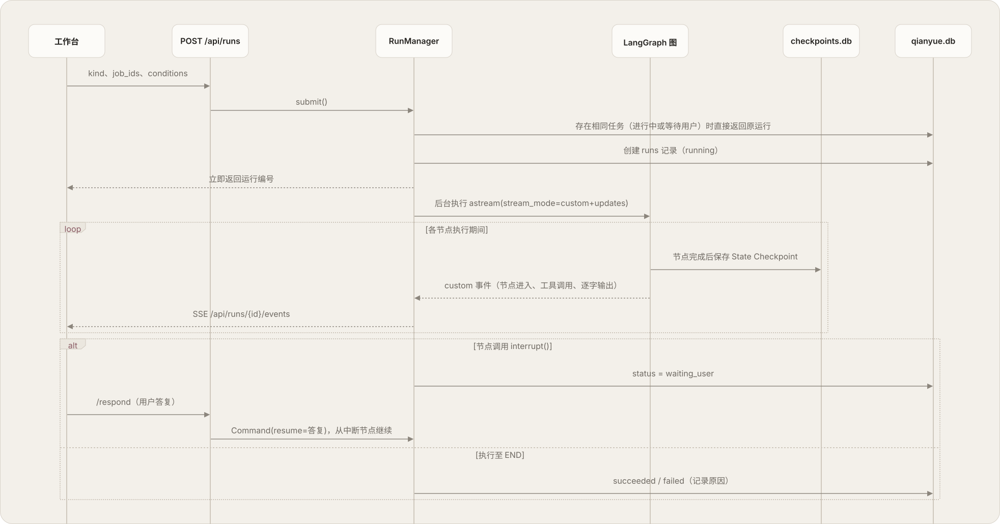

**运行执行器**（`app/graphs/runner.py`）：

- `submit()` 先查询 `runs` 表中同类型、同岗位、同要求且仍在进行或等待用户处理的运行；如存在则直接返回，不重复发起（`app/db/runs.py` 的 `find_active`）。采集任务同一时间只能运行一个。
- 每次运行均在 `asyncio.create_task` 中执行。接口立即返回，进度通过 `EventLog` 推送给订阅者；订阅者始终从第一条事件开始读取，因此稍后连接 SSE 也不会遗漏已经发生的节点事件。
- 图中的节点通过 `get_stream_writer()` 发送 `custom` 事件（`app/graphs/common.py` 的 `announce`），执行器将其转换为「读取材料」「调用模型」等进度信息，并写入 `runs.step`。
- 运行编号即 LangGraph 的 `thread_id`。**从断点继续**时输入为 `None`，LangGraph 从 Checkpoint 读取 State，仅执行未完成的部分。服务启动时，将上次未结束的运行标记为失败，但仍可继续执行。
- 一次运行可包含多个岗位，各岗位的处理结论（`done` 已生成、`reused` 复用、`blocked` 前置检查未通过、`failed`……）累积在 State 的 `results` 中；任一项未成功完成，整次运行即标记为失败，并记录对应项目。
- 批量评估的并发数由 LangGraph 的 `max_concurrency` 控制，默认值为 3。

**状态流转**：`running` → `succeeded` / `failed` / `cancelled`，执行过程中可进入 `waiting_user`（定制简历等待用户确认、模拟面试等待用户回答）。

**评估报告复用。** `app/graphs/evaluation.py` 根据规则文件、JD、材料版本和本次条件计算 `input_hash`。输入未变时复用已有评估报告。显式要求重新评估时，系统重新生成报告。

## 4. 九张业务图

各工作流按业务需要组合节点。以下以岗位评估为例说明前置检查和输出校验，再列出其他流程按需使用的节点。

- 评估图首先读取材料和岗位，并执行 `precheck`。缺少简历、JD 不完整或超出 Token 预算时，在此记录结论并直接进入 END，不调用模型。
- 评估图在模型调用后执行 `validate`，由程序校验输出。校验不合格时，将原因作为反馈交回模型重写，最多重试 2 次（`app/graphs/common.py` 的 `MAX_RETRIES`）；仍不合格则进入 END 并记录原因。
- 包含措辞核对的图额外设置 `wording` 节点：模型再次对照原文核对并标记发现的问题，不退回重写（第 9 节）。
- 需要等待用户输入的节点调用 `interrupt()`。用户答复后，该节点会从头重新执行，因此此类节点不执行写库等副作用操作。

图中方框名称与代码中的 `add_node` 名称一致，括号内为界面显示的进度信息。

### 岗位评估 `app/graphs/evaluation.py`

单次运行通过 `Send` 将各岗位分发至独立的单岗子图并行执行。



- 模型依据 `backend/prompts/evaluation.md` 对八个维度给出 1–5 分（或不可评估）并撰写依据；`app/llm/evaluation.py` 按固定权重计算总分（不可评估的维度不计入分母）、信息覆盖率、置信度和结论。
- `recheck`：总分位于结论分数线（3.5、4.0、4.5）上，或低于分数线 0.1 时，使用相同输入并行复评两次，每个维度取三次评分的中位数。
- Prompt 中固定材料置前、各岗位不同的 JD 置后，使批量评估的请求具有相同前缀，以便服务商命中前缀缓存。

### 能力画像 `app/graphs/profile.py`


多个岗位对同一能力的要求数量由程序统计，不交由模型计数；「有」「部分有」的依据必须逐字来自用户材料，并由程序核验。

### 定制简历 `app/graphs/tailoring.py`


- `retrieve` 是 RAG 的检索环节：将 JD 拆分为独立要求，每条要求作为一个查询，在补充资料和 STAR 经历中检索证据（第 6 节）。基础简历完整提供给模型，不参与检索。
- 模型仅输出按行号定位的修改（替换、删除、插入、移动），每条修改均附带对应的 JD 原文和证据编号；`app/llm/tailoring.py` 校验行号越界和重叠、证据是否存在、新内容中的数字和技术词是否有出处，然后将修改应用到基础简历。
- `review` 向用户展示方案并暂停图执行，State 持久化至 Checkpoint，服务重启后仍可恢复。用户提交接受的修改编号及自行修改的内容后，运行从该节点继续。

### 公司研究 `app/graphs/research.py`


`research` 节点内部是一个 ReAct Agent（第 5 节）。外层图仅负责前置的岗位读取与检查，以及后续的引用来源校验和报告保存。

### 沟通建议 `app/graphs/communication.py`


`advise` 中的 Agent 按需检索用户材料，并读取该岗位的评估报告和公司研究报告。草稿仅保存为成果，不对外发送；阶段仅提供建议，不执行修改。

### 面试准备 `app/graphs/interview_prep.py`


该图采用固定流程与检索，不使用 ReAct：本地材料直接读取；`experiences` 由程序固定执行两次搜索，查询为「公司 + 岗位核心词 + 面经」，仅保留提及目标公司的结果，不由模型决定查询内容。即使未检索到结果，仍继续生成题目。

### 模拟面试 `app/graphs/mock_interview.py`


- `ask` 使模型以面试官身份生成一轮发言，并逐字推送至前端；`listen` 调用 `interrupt()`，中断执行并等待回答。完整问答记录保存于 Checkpoint；断线、关闭页面或服务重启后，重新连接可接收当前问题及此前的问答。
- 问答通过 WebSocket 传输（`app/api/interviews.py`）。该接口仅负责传输：将问题推送至前端，并将回答作为 `Command(resume=...)` 交还给图。

### 采集 `app/graphs/collection.py`


单次运行包含若干搜索任务（平台 × 关键词 × 城市），`collect` 每次处理一个搜索，完成后保存 Checkpoint；中断恢复时不重复执行已完成的搜索。每个搜索先读取完整列表（必要时翻页），再逐项读取详情；读取与停止规则见第 8 节。采集中唯一调用模型的环节是基于职位名进行相关性筛选（`app/llm/relevance.py`）。

### 识别截图 `app/graphs/screenshot.py`


只在没有模型 Key 时使用：添加岗位、添加沟通带的截图由用户的 Agent 读（第 7 节）。`read` 从 `data/uploads/` 取图，调用与截图接口相同的 `read_screenshots`（格式不合格退回重写一次），再用 `save_job` 或 `save_communication` 保存；有 Key 时接口当场识别，不经过这张图。

## 5. ReAct Agent 与总控 Agent

ReAct 指模型根据当前上下文自主选择工具及调用次数，并在获得工具结果后决定后续操作，直至形成结论。迁跃包含三个此类 Agent，均通过 LangChain 的 `create_agent` 构建：

| Agent | 所在位置 | 可用工具 | 结论校验方式 |
| --- | --- | --- | --- |
| 公司研究 | `research` 节点 | `web_search` `read_page`（`app/tools/research.py`） | 引用的来源编号必须由工具实际返回；「已读原文」状态由程序标注（`app/llm/research.py`） |
| 沟通建议 | `advise` 节点 | `search_materials` `read_report`（`app/tools/job.py`） | 所引对方原话必须逐字存在；草稿中的数字和技术词必须有出处，且不得包含手机号（`app/llm/communication.py`） |
| 总控 Agent（工作台内置助手） | 对话接口 | 13 个工具（`app/tools/workspace.py`） | 保存的 JD 和聊天内容必须来自用户消息原文 |

**图节点内的 Agent**（`app/graphs/agent_loop.py`）：使用 `checkpointer=False` 构建，不单独保存断点，节点重新执行时从头开始。最终回答由 `parse` 解析并校验；不合格时，将原因作为新消息追加至原对话并要求模型修正，最多额外重试 2 次。工具自身设有调用上限（研究最多搜索 6 次、读取 4 个网页，见 `app/tools/sources.py`），`recursion_limit` 仅作为兜底限制。

**来源登记**（`app/tools/sources.py`）：搜索结果和已读取网页均登记为 S1、S2……等编号。模型仅引用编号，不直接处理完整链接；程序根据登记表将编号还原为链接，并确定哪些来源实际打开过原文。

**总控 Agent**（`app/graphs/assistant.py`）是工作台内置的主要对话入口，本身不执行岗位评估或简历撰写，仅负责查看岗位与成果、保存用户提供的内容，以及将任务交接给专员。


- **Middleware**：`Timestamps` 为消息记录时间；`ChatSummarizer`（继承 LangChain 的 `SummarizationMiddleware`）在对话达到输入预算的 60% 时，将较早部分替换为摘要，最近约 25% 预算的对话保持原样，摘要规则位于 `backend/prompts/chat_summary.md`；`HumanInTheLoopMiddleware` 使用 `per_call` 模式，仅在修改阶段的调用前暂停，同一轮中的其他工具照常执行。
- **交接（Handoff）**：`hand_off` 工具调用共享的 `start_task` 发起专员运行，转发其事件流中的进度；运行结束后，将成果开头的原文作为 `result` 事件推送至前端，逐字保持不变；工具结果要求模型不要复述结论。
- **原文核对**：`add_job`、`save_communication` 接收的 JD 和聊天内容，由程序通过 `find_original` 在用户消息中定位对应原文（支持「开头……结尾」形式），并保存用户原文。用户发送截图时，图中文字无法与消息原文核对，因此保存模型依据截图完整转写的内容。
- **被中断的工具调用**：上一轮执行中途断开时，为模型已发起但未收到结果的工具调用补充一条「被打断」结果（`unanswered_calls`），避免模型接口报错并保证对话可以继续。
- 单轮对话的事件包括：`token`、`tool`、`run`、`progress`、`result`、`confirm`、`done`（`stream_turn`）；对话接口在最前面添加一条 `conversation` 事件（对话编号）。

## 6. RAG

RAG 先从资料中检索相关片段，再将片段提供给模型生成内容。迁跃在同一个 Qdrant 本地库（`data/vectors/`）中维护两个相互独立的向量集合：

| 集合 | 存储内容 | 使用方 | 代码位置 |
| --- | --- | --- | --- |
| `materials` | 基础简历、补充资料、STAR 经历的当前版本 | 定制简历与面试准备的证据检索；沟通建议的 `search_materials`；`/api/knowledge/search` | `app/rag/knowledge.py` |
| `workspace` | 材料、岗位 JD、沟通记录、全部成果、内置助手对话 | 检索页、内置助手和 MCP 的 `search_workspace` | `app/rag/workspace.py` |

两个集合分离的原因是：证据检索只能使用用户材料。若岗位 JD 或 AI 生成的报告混入证据，模型可能将 JD 要求或报告推断误用为用户经历。

评估不使用检索：基础简历、补充资料和 STAR 经历均完整提供给模型（超出容量时按预算裁剪），因为八个维度都需要结合完整内容判断。

**材料检索**：


- **切分**（`app/rag/chunking.py`）：按 Markdown 标题切分，一段工作经历、一个项目或一段 STAR 分别形成片段，并保留标题路径。标题一同参与向量化，「项目经历 > 客服助手」本身即包含重要语义。
- **对齐**：向量库是派生数据。每次检索前根据 `documents.is_current` 对齐；材料保存新版本后，旧版本片段不再参与检索。删除 `data/vectors/` 后会自动重建。
- **重排**：向量召回速度较快但精度有限；交叉编码器将查询和片段作为整体读取，判断更准确但速度较慢，因此仅对少量召回候选重新排序。
- **RRF**（倒数排名融合）：某片段在某个查询中排名第 r 位时，得分为 1 / (60 + r)，再将各查询得分相加。该算法只使用名次，不使用原始分数，因为重排模型的分数不够稳定，而名次更可靠。
- 向量计算和重排均在本机执行，材料无需为这两个步骤发送给外部模型服务。

**全局检索**：

- 记录来自岗位、材料、沟通、成果（`collect_items`）和内置助手对话（检索接口从 Checkpoint 读取后传入），每条记录均带内容指纹。检索前进行对齐：补充新记录、重建指纹变化的记录、移除已删除记录。
- 同时执行两路检索：语义检索（向量，前 30 名）和字面检索（英文与数字整词、中文相邻两字一组，前 30 名）；RRF 合并后取前 16 个结果交给重排模型。「Kafka」等术语更适合字面检索，「做 RAG 的那家公司」等表述更适合语义检索。
- 查询包含英文词（通常是技术名词）时，包含全部这些词的片段优先排列；同一条记录最多返回 2 个片段；未发生字面命中时标记为「意思相近」；返回命中位置供前端高亮。

## 7. MCP

MCP 是供 AI Agent 连接外部工具的标准协议，在迁跃中属于可选的外部 Agent 接入方式，并非工作台内置助手或其他 AI 功能的运行前提。迁跃使用官方 Python SDK（`mcp` 2.x），通过 Streamable HTTP 将 MCP Server 挂载在同一后端的 `/mcp`，使工具可以直接复用后端数据库和同一个 `RunManager`。


- **与内置助手共享操作。** `app/tools/operations.py` 集中处理岗位查询、内容保存、任务发起和成果读取。工具入口将返回值整理成 Agent 可使用的内容。
- 工具注解向客户端说明操作的读写特性。连接参数、按用途分类的工具列表和使用限制见[使用指南](usage.md#通过-mcp-接入外部-agent)。

- **4 类 Resource**（按地址读取的数据）：`qianyue://overview`、`qianyue://jobs/{编号}`、`qianyue://artifacts/{编号}`、`qianyue://documents/{kind}`。
- **任务范围与模型**：`run_task` 支持评估、能力画像、定制简历、公司研究、沟通建议和面试准备，`collect_jobs` 负责岗位采集；设置页填了 Key 时迁跃任务使用该模型，没填时由外部 Agent 代答（见下一条）。MCP 模拟面试与工作台的 WebSocket 共用运行编号、问答断点和复盘；服务端核对题号，避免重复提交把答案交到下一题。
- **材料修改使用 elicitation**：保存简历、补充资料或 STAR 经历前，迁跃通过 MCP 确认框直接向用户展示全文，不经过外部 Agent；材料中原先不存在的数字和技术词也列在确认框中。客户端不支持时不保存。
- **长任务**：`run_task`、`collect_jobs` 默认等待 3 分钟，期间通过 MCP 进度通知返回进度；超时仍未完成时返回运行编号，之后可使用 `get_task` 查询。
- **与内置助手的差异**：外部 Agent 传入的 JD 无法与用户消息原文核对；修改阶段前是否请求用户确认由其宿主决定。因此，相关约束写入 Server 说明和工具说明。
- **没有 Key 时由外部 Agent 代答**（`app/llm/agent_model.py`、`app/mcp_server/handoff.py`）：`resolve_mcp_model` 在没配 Key 时给出 `AgentChatModel`。它是一个 LangChain 聊天模型，`_agenerate` 不请求 API，而是把消息（经 `mask_payload` 脱敏，与 `PrivateChatModel` 同一套规则）和 `bind_tools` 绑定的工具定义交给 `AgentBroker` 挂成请求，等 Future 被交回。`RunManager` 收到请求时在事件流里发 `model_request`，正在跟进度的 MCP 工具（`_follow`）随即把请求写成文字返回给 Agent；`answer_model_request` 交回文字或工具调用后继续跟，返回下一个请求或最终结论。所以各张业务图、提示词、程序校验、不合格重试、保存、进度与断点都不用改，和有 Key 时一致；ReAct 的工具由 Agent 指定、迁跃执行，研究报告的来源仍可核对。同一运行中前缀相同的后续请求只发增量，相同的系统要求不重复。代答时评估跳过分数线复评（`independent_samples=False`），并发为 1；30 分钟不交回抛 `AgentNoReply`，运行失败、可从断点继续。MCP 的 sampling（服务端借用客户端模型）在 2026-07-28 版规范已弃用、主流客户端也不支持，因此没有采用。
- **截图也交给 Agent**（`app/graphs/screenshot.py`、`app/core/uploads.py`）：没配 Key 时截图接口先把图存进 `data/uploads/`（7 天清理），发起 `screenshot` 运行并返回 202。这张单节点图用同一个 `read_screenshots` 和 `AgentChatModel`，读出的 JSON 用和接口相同的 `save_job`、`save_communication` 保存。`request_reply` 把请求里的图片作为 MCP 图片内容附在文字后面，并写上本机路径作兜底；增量请求不重发图片。`RunRead.agent` 告诉前端运行是在等 Agent 接手（`waiting`）还是 Agent 已在做（`working`）。助手没 Key 时不运行，前端把用户的话和截图编号（`POST /api/uploads`）交给 Agent，Agent 用 `view_screenshots` 看图。

## 8. 岗位采集

采集分为三层，各层不感知其他层的内部实现（`app/collectors/base.py`）：

| 层级 | 职责 | 代码位置 |
| --- | --- | --- |
| 浏览器 | 打开指定地址并返回页面最终状态，或保留同一标签页连续翻页 | `app/collectors/browser.py` |
| 平台适配器 | 构造特定平台的搜索地址、处理翻页、解析列表和详情；实现由纯函数和若干在页面内执行的读取脚本组成 | `app/collectors/platforms/` |
| 采集图 | 确定读取页面、等待时长、停止条件、筛选方式与入库逻辑 | `app/graphs/collection.py` |

- **直接使用调试协议（CDP）**：不使用 Playwright 等自动化库。自动化库连接浏览器时会启用 `Runtime.enable`，BOSS 直聘检测到后会在数秒内清空页面。迁跃仅使用四类命令：启用网络监听、打开地址、读取接口响应、在页面内执行读取脚本。每次均按“新建标签页、建立连接、执行读取、断开连接并关闭标签页”的顺序操作。
- **后台静默运行**：标签页在后台打开，不将浏览器窗口置于前台。后台页面不响应滚动，因此仅对 BOSS 直聘和智联招聘的滚动加载列表页启用焦点仿真（`Emulation.setFocusEmulationEnabled`），其他页面不启用。
- **停止信号**（`app/collectors/signals.py`）：仅依据状态码、最终地址路径和页面开头的明确提示判断。检测到登录页、验证页、401/403/429 或页面被清空时，停止当前平台并跳过该平台的后续搜索，其他平台照常执行；同时在前台打开停止时的页面，供用户处理。不重试，也不改用其他读取方式。
- **访问节奏**（`app/collectors/pacing.py`）：翻页、读取详情以及同平台两次搜索之间均等待一段随机时间，每个平台每 24 小时最多新增 200 个岗位。具体等待区间和上限见该文件中的常量。
- **去重**：按链接和 JD 指纹去重，已有完整 JD 的岗位不再打开详情页；用户删除过的岗位不会再次采集。近似重复（更名后重新发布、跨平台转载）仅作标记（`app/db/similar.py`），不合并。
- **筛选**（`app/collectors/filters.py`）：薪资、经验年限和排除词仅依据列表字段判断；被筛除的岗位不读取详情，也不保存。

## 9. 模型生成与程序校验

大模型可能生成虚构内容（幻觉），也可能将「参与」改写为「负责」。迁跃采用以下约束：所有可由程序核对的内容均由程序校验；无法由程序完全核对的内容再由模型复核并标记给用户，不代替用户作出判断。

| 功能 | 模型输出 | 程序校验或计算 | 代码位置 |
| --- | --- | --- | --- |
| 评估 | 各维度评分、评分依据与硬性阻断 | 总分、覆盖率、置信度和结论；「已确认」的硬性阻断必须具有逐字匹配的原句，否则降级为待核实 | `app/llm/evaluation.py` |
| 能力画像 | 能力项及对照结论 | 多个岗位的能力要求数量由程序统计；依据必须逐字来自用户材料 | `app/llm/profile.py` |
| 定制简历 | 按行号定位的修改 | 行号是否越界或重叠；证据编号是否存在；新内容不得包含材料之外的数字和英文技术词 | `app/llm/tailoring.py`、`app/llm/facts.py` |
| 公司研究 | 结论和引用的来源编号 | 来源编号必须由工具实际返回；未阅读原文支持的陈述置信度最高为中；「有风险」必须具有已阅读原文的来源；主体未确认时只能判定为信息不足 | `app/llm/research.py` |
| 沟通建议 | 对话分析和回复草稿 | 对方原话必须逐字存在；草稿中的数字和技术词必须有出处；不得包含手机号 | `app/llm/communication.py` |
| 面试准备 | 题目、回答要点和面经题 | JD、简历和面经的引用必须逐字可查；回答要点中的数字和技术词必须有出处；面经题最多 4 道 | `app/llm/interview_prep.py` |
| 模拟面试复盘 | 每轮评价和更好的回答 | 对用户原话的引用必须逐字核对 | `app/llm/mock_interview.py` |
| STAR 整理 | 四部分内容 | 四部分均须完整；数字和技术词必须来自用户在该段对话中的表述 | `app/llm/star.py` |
| 措辞核对 | 指出新内容超出原文的具体措辞，并逐字列明差异 | 所列文字必须存在于新内容中，且并非原文已有内容；无法匹配的标记不采纳 | `app/llm/factcheck.py` |

措辞核对适用于定制简历、沟通草稿和模拟面试的「更好的回答」。该环节同样由模型执行，可能存在误判，因此仅标记问题，不触发退回重写。

**输出解析**（`app/llm/parsing.py`）：通过 Pydantic 模型解析模型输出的 JSON；不合格时抛出 `InvalidOutput`，错误信息指明具体字段，并作为重试反馈返回模型。

## 10. 数据模型与本地存储

业务数据存储在 `data/qianyue.db`，由 SQLModel 定义 9 张表。表结构集中在 `app/db/models.py`，读写逻辑按领域拆分在 `app/db/` 的其他模块中。

| 表 | 职责 | 关键字段 |
| --- | --- | --- |
| `jobs` | 保存岗位、JD 全文、来源与应聘阶段 | `id` `source` `url`（唯一） `company` `title` `city` `salary` `company_size` `industry` `posted_at` `jd_text` `jd_hash` `stage` `note` `similar_to` `created_at` `updated_at` `deleted_at` |
| `job_events` | 保存每次应聘阶段变更及实际发生日期 | `id` `job_id` `from_stage` `to_stage` `happened_on` `note` `created_at` |
| `documents` | 保存基础简历、补充资料和 STAR 经历的各个版本 | `id` `kind` `title` `content_md` `content_hash` `is_current` `created_at` |
| `artifacts` | 保存评估、简历、研究、建议、面试等成果的正文与结构化结果 | `id` `kind` `job_id` `run_id` `title` `content_md` `data_json` `score` `input_hash` `created_at` `updated_at` `deleted_at` |
| `runs` | 保存任务运行状态、当前步骤、输入与错误 | `id` `kind` `job_id` `status` `step` `error` `input_json` `created_at` `updated_at` `finished_at` |
| `communications` | 保存用户提供的招聘沟通记录 | `id` `job_id` `speaker` `text` `created_at` |
| `settings` | 保存设置页中的单行模型与搜索配置 | `id` `llm_base_url` `llm_model` `llm_api_key` `search_provider` `search_api_key` `hide_personal_info`（默认开启）`privacy_terms` `updated_at` |
| `conversations` | 保存助手对话的自定义标题；对话正文位于 Checkpoint | `id` `title` `updated_at` |
| `search_history` | 保存检索页的查询历史 | `id` `query` `type` `hits` `created_at` |

主要数据约束如下：

| 约束 | 说明 |
| --- | --- |
| 枚举值 | `documents.kind` 为 `resume` / `supplement` / `star`；`runs.kind` 和 `artifacts.kind` 分别对应八类运行与七类成果；`runs.status` 为 `running` / `waiting_user` / `succeeded` / `failed` / `cancelled` |
| 岗位状态 | `jobs.stage` 只记录用户修改的应聘阶段；处理进度 `prep` 由 JD 和未删除的评估报告实时计算，不落库。完整规则见 [usage.md](usage.md#岗位生命周期) |
| 沟通记录 | `communications.speaker` 为 `recruiter` / `me` / `transcript`；同一岗位下相同内容只保存一次 |
| 幂等与复用 | `runs.id` 同时作为 LangGraph `thread_id`；`artifacts.input_hash` 由规则文件、JD、材料版本和任务条件计算。输入未变时复用成果，显式 `force` 重做时覆盖原成果 |
| 删除与版本 | 岗位和成果采用 `deleted_at` 软删除；材料每次保存生成新版本，通过 `is_current` 标记当前版本，内容未变时不新增版本 |

LangGraph 按运行编号在 `data/checkpoints.db` 中保存断点和对话状态。Qdrant 的 `materials` 和 `workspace` 集合由当前材料、岗位、成果和对话等内容派生，索引可重建。业务记录和断点各自保存恢复任务所需的状态。

设置页保存的 Key 以明文存储在本机 `settings` 表，`.env` 中的 Key 同样仅用于本机配置。设置接口默认只返回配置状态和末四位，日志不得记录 Key。备份与迁移操作见 [usage.md](usage.md#数据存储与隐私)。

## 11. 工程化实现

- **模型工厂**（`app/llm/factory.py`）：全项目仅在此处选择模型服务商，统一使用 OpenAI 兼容协议；切换兼容服务时只需修改设置。未配置 Key 时应用仍可启动，调用时返回明确提示。设置页保存的配置覆盖 `.env`，并在保存后立即生效（`app/db/app_settings.py`）。
- **Token 预算**（`app/llm/tokens.py`）：中文字符按 0.7、其他字符按 0.35 估算 Token，调用前拦截明显过长的输入并裁剪选填材料。每张截图按 1500 Token 计算。
- **请求编号和运行编号**：中间件（`app/core/middleware.py`，采用纯 ASGI 实现，SSE 期间仍保留编号）为每个请求生成编号并写入 ContextVar，同时写入响应头 `X-Request-ID`；运行在后台任务中执行时，将运行编号写入另一个 ContextVar。日志过滤器（`app/core/logging.py`）将两个编号写入每行日志，可通过运行编号 `grep` 追踪一次评估的完整过程。Key 不写入日志。
- **SSE**：运行进度（`/api/runs/{id}/events`）和内置助手对话（`/api/chat/stream`）均采用服务端持续推送。前端的 `RunsProvider` 使用 `EventSource` 订阅进行中的运行。
- **WebSocket**：模拟面试需要双向实时通信（逐字下发问题、上行回答），因此使用 WebSocket（`app/api/interviews.py`）。
- **进程内排队**：采用“先查询、后写入”方式的写入操作（添加岗位、修改阶段、保存沟通记录），通过 `app/db/engine.py` 的 `serialized` 排队执行，避免并发重复请求产生重复记录。

## 12. 项目目录与代码入口

目录树展开到主要功能模块。`data/` 中的文件会随启动和使用逐步生成，构建产物按目录列出。

```text
qianyue/
├── backend/                          # Python 后端
│   ├── app/                          # FastAPI 应用及业务实现
│   │   ├── main.py                   # 创建应用，挂载 API、MCP 和前端页面
│   │   ├── api/                      # 按业务划分的 HTTP、SSE 和 WebSocket 接口
│   │   ├── core/                     # 配置、日志、请求上下文和中间件
│   │   ├── db/                       # 数据表定义、数据库连接与读写操作
│   │   ├── collectors/               # 专用浏览器、岗位筛选、访问节奏和平台注册
│   │   │   └── platforms/            # 四个招聘平台的列表与详情适配器
│   │   ├── graphs/                   # 工作流、助手和运行执行器
│   │   ├── llm/                      # 模型调用、计分、事实校验与输出解析
│   │   ├── rag/                      # 材料切分、向量检索、重排和全局检索
│   │   ├── tools/                    # 助手工具、共享工作区操作和联网查询
│   │   └── mcp_server/               # 向外部 Agent 提供 MCP 工具和资源
│   ├── prompts/                      # 评估、简历定制、面试等任务的提示词
│   ├── scripts/                      # 岗位采集与模拟面试的命令行入口
│   ├── .env.example                  # 模型服务、搜索与运行参数的配置模板
│   ├── .python-version               # 后端使用的 Python 版本
│   ├── pyproject.toml                # 后端项目与依赖声明
│   └── uv.lock                       # uv 锁定的依赖版本
├── frontend/                         # React 工作台
│   ├── src/                          # 前端源码
│   │   ├── main.tsx                  # 工作台入口
│   │   ├── app/                      # 路由、页面布局、主题和任务面板
│   │   │   ├── runs/                 # 运行状态与进度订阅
│   │   │   └── guide/                # 新手指引
│   │   ├── pages/                    # 总览、岗位、采集、材料、成果、检索、助手和设置页面
│   │   ├── api/                      # 调用后端接口的客户端
│   │   ├── reports/                  # 评估报告、Markdown 成果和导出控件
│   │   ├── ui/                       # 按钮、弹窗、截图输入等共用组件
│   │   ├── demo/                     # 示例数据快照、假后端与模式开关
│   │   ├── lib/                      # 日期、来源和评估结论等展示逻辑
│   │   └── styles/                   # 全局样式与设计变量
│   ├── public/                       # 随工作台分发的静态资源
│   ├── scripts/                      # 复制字体许可、导出示例快照、截图与记录构建指纹
│   ├── dist/                         # 已构建的工作台，启动时由后端直接提供
│   │   ├── index.html                # 构建后的页面入口
│   │   ├── assets/                   # 打包后的 JavaScript、CSS 和字体
│   │   └── third-party-licenses/     # 随字体分发的许可文件
│   ├── dist-demo/                    # 演示版构建产物，供品牌页复制到在线演示
│   ├── index.html                    # Vite 构建使用的 HTML 入口
│   ├── package.json                  # 前端依赖与开发命令
│   ├── package-lock.json             # npm 锁定的依赖版本
│   ├── tsconfig.json                 # TypeScript 配置（另有 tsconfig.app / .node）
│   └── vite.config.ts                # 前端构建配置
├── data/                             # 本机业务数据，首次启动后生成，以下为默认位置
│   ├── qianyue.db                    # 岗位、材料、成果、沟通记录和设置
│   ├── checkpoints.db                # 任务断点、模拟面试问答与助手对话历史
│   ├── vectors/                      # 由工作区内容生成的本地检索索引
│   ├── models/                       # 下载到本机的检索模型
│   ├── browser/                      # 专用 Chrome 的用户目录和登录状态
│   └── logs/                         # 应用运行日志
├── docs/                             # 项目文档
│   ├── usage.md                      # 操作指南、接口示例和故障排查
│   ├── architecture.md               # 系统架构、工作流与源码入口
│   └── disclaimer.md                 # 平台规则、本地存储与免责声明
├── media/                            # README 与文档的配图
│   ├── readme/                       # README 配图
│   │   ├── hero.gif                  # 项目标题图
│   │   ├── architecture.svg          # 系统架构图
│   │   ├── badges/                   # 技术与平台徽章
│   │   └── screenshots/              # 工作台界面截图和动图
│   └── docs/                         # 架构说明配图
│       ├── *.svg                     # 系统、运行、各业务图等 15 张成品图
│       └── src/                      # 对应的 15 个 mermaid 源文件（.mmd）
├── scripts/start/                    # 启动环境检查、依赖准备与服务启动（start.sh、start.ps1）
├── tools/                            # 本机缺少 uv 时由启动脚本创建
├── start.bat                         # Windows 双击启动入口
├── start.command                     # macOS 双击启动入口
├── README.md                         # 项目首页与快速开始
├── LICENSE                           # 项目许可证
├── .gitattributes                    # 启动脚本的检出换行符规则
└── .gitignore                        # 本地文件和构建产物的版本控制规则
```

### 按功能查找源码

| 要修改的功能 | 从这里开始 |
| --- | --- |
| 模型指令、评估权重或输出校验 | [业务提示词](../backend/prompts/)、[评估计分](../backend/app/llm/evaluation.py)、[事实校验](../backend/app/llm/facts.py) |
| 工作流步骤、暂停与恢复 | [各业务工作流](../backend/app/graphs/)、[运行执行器](../backend/app/graphs/runner.py) |
| 助手和 MCP 的读写操作 | [共享操作](../backend/app/tools/operations.py)、[助手工具](../backend/app/tools/workspace.py)、[MCP 入口](../backend/app/mcp_server/server.py) |
| 材料证据检索或全局搜索 | [材料检索](../backend/app/rag/knowledge.py)、[全局检索](../backend/app/rag/workspace.py) |
| 平台采集与访问节奏 | [平台适配器](../backend/app/collectors/platforms/)、[节奏控制](../backend/app/collectors/pacing.py) |
| 页面、接口或持久化字段 | [工作台页面](../frontend/src/pages/)、[HTTP 接口](../backend/app/api/)、[数据表](../backend/app/db/models.py) |
